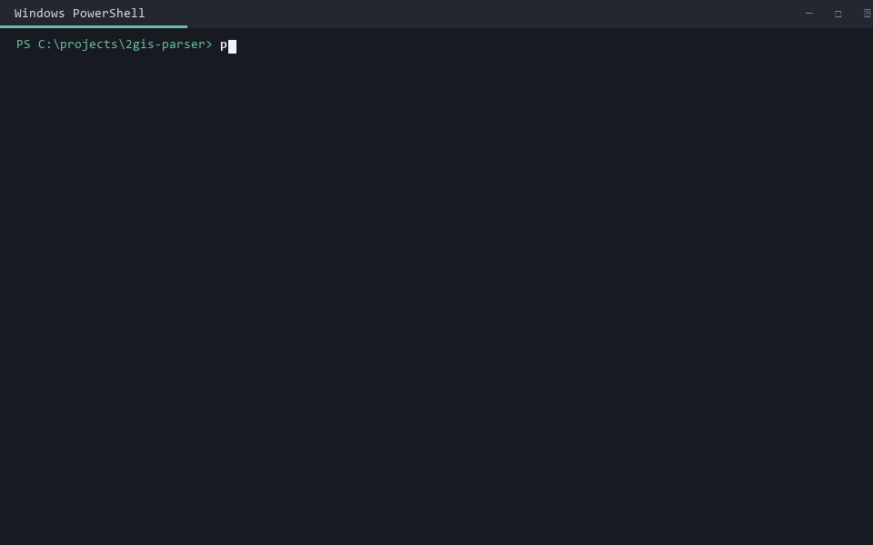

<div align="center">

# 2GIS Parser

### Python-инструмент для сбора карточек организаций из 2GIS по городам, рубрикам и поисковым запросам

`Python` &nbsp;·&nbsp; `Playwright` &nbsp;·&nbsp; `Chrome CDP` &nbsp;·&nbsp; `SQLite` &nbsp;·&nbsp; `Excel / CSV / JSONL`

[Быстрый старт](#быстрый-старт) · [Возможности](#возможности) · [Как устроен-сбор](#как-устроен-сбор) · [Данные на выходе](#что-на-выходе) · [Ограничения](#ограничения)

</div>



> **Для чего:** собрать воспроизводимую базу организаций из 2GIS — с телефонами, адресами, графиком работы, координатами, рубриками, сайтами, социальными сетями и рейтингом. Тема, страна и города меняются через `config.yaml`, без правки кода.

## Возможности

| Задача             | Как решается                                                                                         |
| ------------------ | ---------------------------------------------------------------------------------------------------- |
| Сбор по своей теме | Поисковые запросы и рубрики 2GIS задаются в `config.yaml` или через CLI                              |
| Полные карточки    | Телефоны и дополнительные поля извлекаются из ответа, который сайт запрашивает при открытии карточки |
| Большие прогоны    | Очередь в SQLite, отдельные процессы Chrome, продолжение после остановки и дедупликация              |
| Командный сбор     | Участники упаковывают результаты в ZIP, координатор сливает их без дублей                            |
| Готовая выгрузка   | CSV, JSONL, XLSX, отчёт о заполненности и статистика по категориям                                   |

Обычный прямой HTTP-запрос к 2GIS не подходит: веб-сайт использует JavaScript-челлендж. Поэтому инструмент запускает системный Chrome с `--remote-debugging-port`, подключается к нему через Playwright CDP и обрабатывает те же ответы, которые получает браузер. Телефоны находятся в ответе `catalog.api.2gis.*/3.0/items/byid`, который сайт запрашивает при открытии карточки.

Тема сбора задаётся в `config.yaml`, код для этого трогать не нужно:

```yaml
collect:
  country: kz
  regions: [almaty]
  queries: ["автомойка", "шиномонтаж", "детейлинг"]
```

Механика от темы не зависит — банкетные залы, автомойки, стоматологии собираются
одинаково.

## Кейс, под который писалось

Изначальная задача — база заведений Казахстана, пригодных для мероприятий: тойханы,
банкетные и конференц-залы, лофты, базы отдыха, рестораны с банкетными залами. Для них
дополнительно вытаскивается вместимость зала и считается балл пригодности.

Алматы собран целиком: 12 931 организация, из них 6 050 подходят под мероприятия.
Телефон есть у 89%, вместимость у 86% площадок. Всего ушло около 5 часов на 8 окнах
браузера, из них 3 часа 2 минуты — финальный непрерывный прогон, остальное пробные
запуски и перезапуски.
Остальные 18 регионов собирает команда, инструкция для участников — в
[PROMPT-AGENT.md](PROMPT-AGENT.md).

Вместимость не додумывается никогда. Нет её у 2GIS — поле пустое.

## Быстрый старт

```bash
git clone https://github.com/VllSunday/2gis-parser
cd 2gis-parser
pip install -r requirements.txt
```

Нужен Python 3.10+ и Google Chrome (Chromium, Brave и Edge тоже подходят, ищутся сами).
`playwright install` запускать не надо: мы цепляемся к системному браузеру, а не
к сборке Playwright — её антибот 2GIS видит.

Дальше проще всего так:

```bash
python run.py doctor    # проверит машину и посчитает, сколько окон открывать
python start.py         # мастер: регион, число окон, запуск
```

Windows проверен на боевых прогонах, на нём собран Алматы. macOS и Linux
поддерживаются — платформозависимого кода нет, пути к Chrome прописаны для всех трёх
систем. На Linux нужен графический сеанс, иначе остаётся только `--headless`, а он
повышает риск нарваться на защитную страницу.

## Команды

```bash
python run.py doctor                     # проверка машины
python run.py regions                    # регионы: коды, объём, что уже собрано
python run.py collect --region shymkent  # сбор
python run.py status                     # состояние очереди
python run.py export                     # пересобрать выгрузку из сырых данных
python run.py pack                       # упаковать результат для отправки
python run.py merge chunk.zip            # влить чужой результат
```

Флаги `collect`, которые нужны чаще всего:

- `--workers 6` — сколько окон браузера поднять;
- `--query "автомойка"` и `--rubric 10803` — разовая тема без правки конфига;
- `--max-seconds 28800` — остановиться через 8 часов, удобно для ночного прогона;
- `--rubric-set core` — только «заведомо площадки», без общепита, втрое быстрее;
- `--max-pages 5` — не глубже N страниц, для пробного запуска;
- `--refresh-regions` — обновить список регионов с data.2gis.com.

Ctrl+C останавливает корректно: текущая карточка дописывается, прогресс сохраняется.
Повторный запуск продолжает с того же места, уже собранное заново не открывается.
Рвать и продолжать прогон можно сколько угодно раз.

## Как устроен сбор

Две фазы, обе разбираются из общей очереди в SQLite.

Фаза A открывает рубрику каталога (`/almaty/rubric/10803`) или поисковый запрос
(`/almaty/search/тойхана`), листает выдачу до конца и выписывает идентификаторы
заведений. Карточки не открывает.

Фаза B открывает каждое найденное заведение ровно один раз за прогон, сколько бы
рубрик и запросов его ни нашли, и вытаскивает поля из перехваченного ответа. В этом
и экономия: заведение попадает в выдачу по десятку источников, а карточка открывается
однократно.

Воркеры — отдельные процессы, у каждого свой профиль Chrome. Сначала разбирают фазу A,
когда она кончилась, переходят на фазу B. Балансировка по факту, а не по плану: задачи
очень разного размера, «Быстрое питание» это 231 страница, «Театры» — три.

Скелет покрытия дают рубрики каталога 2GIS (60 штук в двух наборах). Рубрика — замкнутое
множество, определённое самим справочником, поэтому покрытие по ней проверяемо.
Поисковые слова (80 штук в четырёх языковых слоях) добирают то, что в рубрику не попало:
ресторан со словом «банкет» в описании лежит в рубрике «Рестораны».

Подход подсмотрен в [interlark/parser-2gis](https://github.com/interlark/parser-2gis)
(LGPL-3.0) — настоящий Chrome, CDP, перехват `items/byid`. Здесь он переписан под задачу:
очередь, две фазы, докачка после перезапуска, дедупликация, нормализация.

## Производительность

Замер на 8 ядрах и 32 ГБ, `tools/bench_workers.py`, карточек в секунду:

```
 2 окна -> 0,78      8 окон -> 2,07
 4      -> 1,23     12      -> 2,05
 6      -> 1,66     16      -> 1,95
```

Упирается в число физических ядер, дальше плато и спад. Антибот за все прогоны, включая
210 страниц подряд, не сработал ни разу — ограничитель это процессор, а не защита сайта.
`run.py doctor` считает подходящее число окон сам, по ядрам и памяти.

Чистое время сбора по регионам: Алматы (43 744 организации) — 3 часа, Шымкент и Астана —
около 1,8 часа, Кокшетау (6,8 тыс.) — полчаса. Все 18 оставшихся регионов на одной
машине это 13–16 часов, на четверых-пятерых — по одной ночи каждому.

## Сбор в несколько рук

Регионы раздаются по людям, каждый гоняет у себя, потом результаты сливаются.
Участник в конце делает `run.py pack` и получает один zip. Координатор вливает всё
к себе:

```bash
python run.py merge from-aidar.zip from-dinara.zip
python run.py export
```

Слияние идемпотентно, один архив можно влить дважды без дублей. Внутри архива сырые
ответы 2GIS и состояние очереди — этого хватает, чтобы пересобрать общую выгрузку.

## Что на выходе

В папке `out/`:

- `venues.csv`, `venues.jsonl`, `venues.xlsx` — сама база;
- `venues_all.csv` — всё собранное, если выгрузка фильтровалась;
- `report.md` — заполненность полей, покрытие по источникам, разбивка по городам;
- `summary.md` и `category_stats.csv` — сводка по категориям;
- `discovered_rubrics.csv` — все встреченные рубрики с числом заведений;
- `possible_duplicates.csv` — пары, похожие на дубли, для ручной проверки.

Колонки описаны в [docs/DATA-FORMAT.md](docs/DATA-FORMAT.md). Выгрузка строится целиком
из сырых JSONL и браузер не трогает, поэтому пересобирать её можно сколько угодно раз,
меняя правила нормализации задним числом.

## Перенастройка под свою тему

Конфигом задаются: тема (`collect.queries`), рубрики каталога (`collect.rubrics`, ID
видно в адресе `/almaty/rubric/10803`), города (`collect.regions`), страна
(`collect.country` плюс `--refresh-regions`, у 2GIS 204 региона в 17 странах), число
воркеров, задержки, глубина пагинации.

Разово то же самое:

```bash
python run.py collect --region almaty --query "автомойка" --query "шиномонтаж"
python run.py collect --region astana --rubric 10803 --rubric 17379
```

Проверялось: тема «автомойки и шиномонтаж» по Кокшетау собралась тем же кодом,
47 организаций, часы работы у всех, телефоны у 77%.

В коде остаётся предметная надстройка под исходный кейс: разбор вместимости зала
(`capacity.py`) и балл пригодности под мероприятия (`classify.py`). Чужой теме они
не мешают — поля просто останутся пустыми, а в выгрузку попадают все собранные
организации. Общие поля собираются для любой организации в справочнике.

Чтобы найти рубрики под свою тему: прогоните пару слов, откройте
`out/discovered_rubrics.csv`, там все встреченные рубрики с числом заведений. Дальше
их ID идут в `collect.rubrics`, и покрытие становится проверяемым.

## Диагностика

В `tools/` лежат скрипты, которыми мерялись цифры выше: `bench_workers.py` (скорость
при разном числе окон), `estimate_region.py` (объём региона до запуска),
`rubric_totals.py` (сколько заведений в каждой рубрике), `rubrics_crawl.py` (обход
каталога рубрик города), `check_depth.py` и `check_totals.py` (глубина пагинации),
`summary.py`, `test_normalize.py`.

## Ограничения

Сбор из веб-версии противоречит пользовательскому соглашению 2GIS. Для проверки
гипотезы и внутренней работы база годится, для коммерческого запуска чистый путь —
платный Places API с доступом к `contact_groups` либо выгрузка через data.2gis.com.
Вопрос стоит закрыть до публичного релиза продукта.

Обновлять уже собранное пока нечем: реестр `seen` защищает от повторного открытия
карточек настолько надёжно, что перечитать устаревшее заведение не получится, флага
сброса нет.
